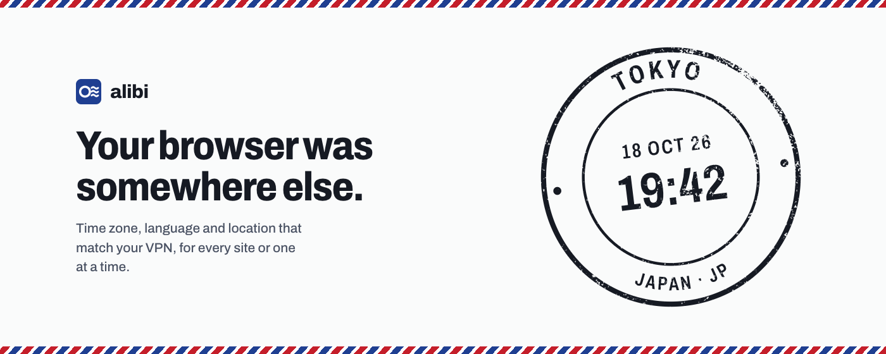
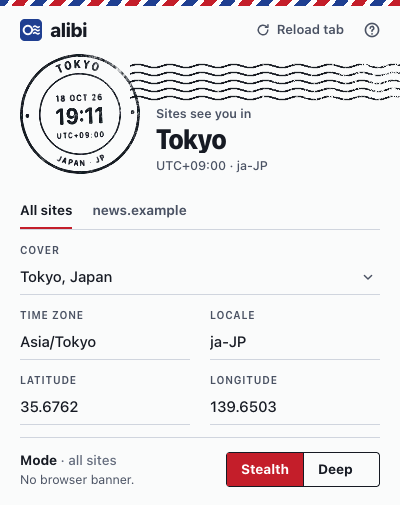
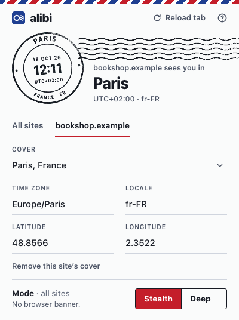
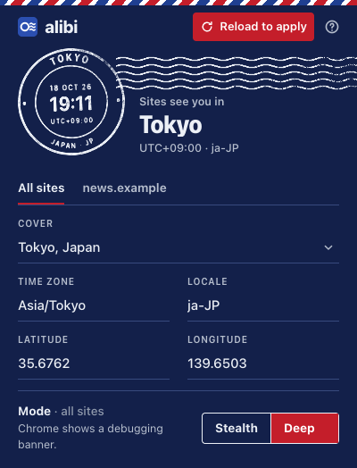

# Alibi



[](https://github.com/doxigo/alibi/actions/workflows/build.yml)

Check what sites see: [doxigo.github.io/alibi](https://doxigo.github.io/alibi/). Download: [latest release](https://github.com/doxigo/alibi/releases/latest).

Alibi is a Chrome extension that spoofs your time zone, geolocation, and locale to any location you choose. The locale also sets `navigator.language` and the `Accept-Language` header, so every place a site can ask tells the same story. Use it to test websites in different regions or to match your location data to your VPN's IP address.

Alibi is a fork of [Cloaq](https://github.com/www1z4rd/cloaq) by www1z4rd and is distributed under the same GPL-3.0 license. Changes from Cloaq: it was renamed, and it adds a Stealth Mode that never attaches the debugger, so Chrome's "started debugging this browser" banner doesn't appear.

## Install

1. Download `alibi-vX.Y.Z.zip` from the [latest release](https://github.com/doxigo/alibi/releases/latest) and unzip it into a folder you'll keep.
2. Open `chrome://extensions` (in Brave, `brave://extensions`) and turn on **Developer mode**.
3. Click **Load unpacked** and pick that folder.
4. Optional, recommended: click **Details** on Alibi and turn on **Allow User Scripts**, so Stealth Mode runs before any page script.

To update, unzip the new release over the same folder and click the reload icon on Alibi's card.

## Screenshots

| Every site | One site, its own cover | Deep mode, dark theme |
|---|---|---|
|  |  |  |

The postmark at the top shows what the current site sees: its city, local time and UTC offset.

## Back it up with Whereabouts


**Alibi gives your browser a story. [Whereabouts](https://github.com/doxigo/whereabouts) makes your whole Mac stick to it.**

A browser extension can only argue from inside the browser. A site's own workers, and the first scripts of a page that loads instantly, read the time zone straight from macOS, and macOS still knows where you really are. Whereabouts is a free, open source menu bar app that closes that gap from the other side. It asks one question all day long: *where does the internet think this Mac is right now?*

- **Your location shows as a place, not a status.** A flag, a country code or a city sits in the menu bar, never just "VPN: connected".
- **When it's wrong, you'll know.** Choose any mix of a red menu bar, a notification, a sound and a red line along the edge of the screen. An optional kill switch cuts the network until you're back where you meant to be.
- **The Mac's clock moves to your exit.** While the VPN is up, macOS switches to the exit's time zone, so every browser, worker and app agrees. The menu bar keeps your real time: `Oslo · 14:32 home`.
- **It catches the quiet leaks.** IPv6 exits, DNS resolvers, an unexpected ISP, and a Mac whose time zone or region tells a different story than its connection.
- **It works with rules about places.** Allow or block countries, expect certain ISPs, or give a site its own location, matched against the browser tab you're on.

| Where a site can look | Alibi | Whereabouts |
|---|:---:|:---:|
| Page scripts, iframes, blob workers: time zone, locale, language, location | ✓ | |
| The `Accept-Language` header | ✓ | |
| The site's own workers and the first scripts of instant pages: time zone | | ✓ |
| Your public IP and VPN exit, with alerts and a kill switch | | ✓ |
| IPv6 and DNS leaks | | ✓ |

Run both, with Alibi on **Match my IP address** so both follow your VPN exit, and every time zone on the [check page](https://doxigo.github.io/alibi/) agrees, including the ones Alibi can't reach. (A site's own workers still read the browser's locale; Alibi's Deep mode covers that.)

## Modes

**Stealth Mode (default).** On every navigation, Alibi injects a script into each frame's page context. The script patches `Intl`, `Date`, `toLocaleString` and `navigator.geolocation`. No debugger is involved, so Chrome shows no banner. Limits:

- New iframes and blob Web Workers get the cover too. Workers started from the site's own files still see the real time zone. Covering them means restarting them from a blob, and on sites whose security policy forbids blob workers that fails silently, breaking the site. Third-party scripts, where fingerprinting usually comes from, can't start file workers (a worker's script must come from the page's own site), so they're limited to blob workers, which are covered. Deep covers file workers too.
- An empty iframe reached through `window.frames[n]` before anything touches its `contentWindow` is still unpatched.
- Determined fingerprinting scripts can detect the patches.

For Stealth Mode to also catch scripts that run the instant a page loads, open `chrome://extensions`, click Details on Alibi, and turn on **Allow User Scripts**. Alibi then registers its patches through `chrome.userScripts`, and Chrome runs them before any page script. With the toggle off, Alibi injects on page commit instead, and inline `<head>` scripts can still see real values when the HTML arrives within a few milliseconds of the headers. The popup shows a hint while the toggle is off.

**Deep Mode.** Turn this on in the popup. Alibi attaches `chrome.debugger` and uses the CDP `Emulation.*` overrides. Spoofing then happens below the page, which is much harder to detect, and cross-site iframes and Web Workers get the cover before their first script runs. Leaving the New Tab page (which the debugger can't touch), Alibi briefly parks the tab on a blank page to attach first, then continues to the site, so even that first page is covered from its first script. One limit remains: when you move between two sites with *different* covers in the same tab and the new page's HTML arrives almost instantly, its first inline scripts can see the previous site's cover (never your real location). Chrome holds debugger commands until the navigation commits, and re-sending the navigation could break form submissions. While it's active, Chrome shows the "started debugging this browser" banner. To use Deep Mode without the banner, launch Chrome with `--silent-debugger-extension-api` ([how to pass flags](https://www.chromium.org/developers/how-tos/run-chromium-with-flags/)).

## Per-site covers

The popup has two tabs. **All sites** holds your usual cover. The second tab is named after the current site: choose **Give it its own cover** and that site, along with its subdomains, gets separate settings. The most specific rule wins, and iframes follow the page they're embedded in. To keep one site on your real location, give it its own cover and set it to **Off (real location)**. Stealth/Deep mode applies to all sites.

## IP Address

Alibi does not change your IP address. Use a VPN or proxy for that, then choose **Match my IP address**. The cover then follows your connection: while any cover uses it, Alibi asks [GeoJS](https://www.geojs.io/) where you appear to be once a minute, so switching VPN exits moves the cover within a minute. Pages already open pick up the new place when they reload. With [Whereabouts](https://github.com/doxigo/whereabouts) moving the Mac's time zone to the exit, the time zone of open pages follows without a reload: while the Mac's zone already matches the IP, Alibi leaves the zone to Chrome, which passes the Mac's zone changes into pages that are already open. Their language, locale and location still change on reload.

## Permission Justification

**scripting, host permissions (all sites):** Stealth Mode needs these to inject its spoofing script into pages.

**declarativeNetRequestWithHostAccess:** Sets the `Accept-Language` request header to match each site's cover.

**userScripts:** Lets Stealth Mode run before page scripts once you turn on "Allow User Scripts". Note: the Chrome Web Store limits this API to user-script managers, so a store build may need to drop it and rely on the injection fallback.

**debugger:** Deep Mode needs this to attach to tabs and emulate location, time zone, and locale.

**webNavigation:** Detects new page loads so Alibi can apply the active mode.

**storage:** Stores settings and preferences.

**alarms:** Re-checks your IP address once a minute while a cover is set to Match my IP address.

## Development

Alibi is built using JavaScript and Tailwind CSS.

```
yarn
yarn build        # outputs to /build
yarn build:store  # Chrome Web Store zip: same build without the userScripts permission
yarn test         # checks stealth time zone math against real TZ processes
yarn testpage     # the check page at http://localhost:8642/, with a second site and delay/policy options
```

### Load the Extension in Chrome

1. Open `chrome://extensions/`.
2. Enable Developer mode.
3. Click "Load unpacked".
4. Select the `build` folder, or the root folder if you're running `yarn watch:css`.

Every push also builds the unpacked extension as a CI artifact (Actions → latest run → `alibi-extension`).

### Releasing

1. Bump `version` in `manifest.json` and commit it.
2. Tag it with the release notes as the message, then push the tag:

   ```
   git tag -a v1.0.1 -m "What changed"
   git push origin v1.0.1
   ```

The Release workflow runs the tests, checks that the tag matches `manifest.json`, and publishes a GitHub Release with `alibi-v1.0.1.zip` (for Load unpacked) and `alibi-v1.0.1-chrome-web-store.zip` (for the store).
